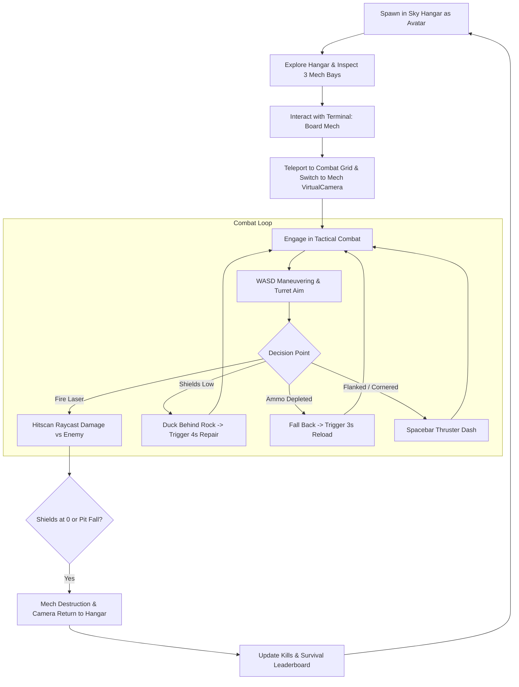
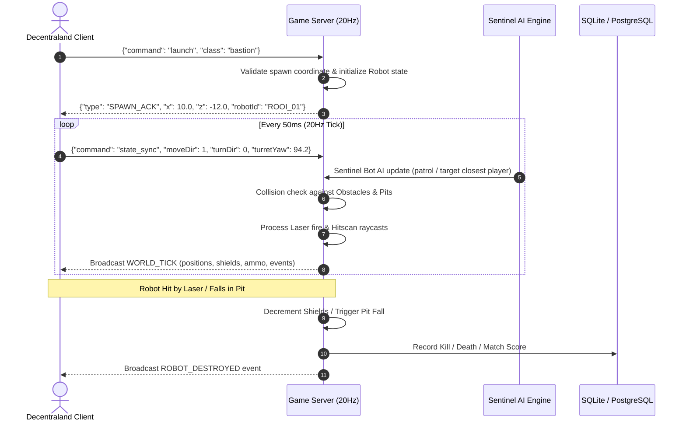
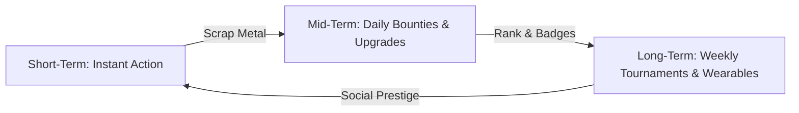

# 🎮 Game Design Document (GDD)
# Toy Robot Worlds: Decentraland Edition

---

## 1. Executive Summary & Game Vision

### 1.1 High Concept
**Toy Robot Worlds: Decentraland Edition** is a fast-paced, tactical 3D multiplayer mech combat arena built in Decentraland SDK 7. Grounded in the authoritative rules and mechanics of the original Java *Toy Robot Worlds* engine, players pilot heavy combat mechs inside an obstacle-ridden cyber-grid arena featuring bottomless pits, line-of-sight laser warfare, and high-stakes vulnerability windows for repairs and reloads.

### 1.2 Core Pillars
1. **Pilot the Machine, Not Just an Avatar**: Avatars step onto hangar launchpads to board modular 3D mechs. The avatar is visually suppressed while a third-person virtual camera locks onto the heavy combat chassis.
2. **Tactical Command Roots in 3D**: Retains the authentic *Robot Worlds* rulebook—discrete forward/turn locomotion, laser capacitor ammo limits, shield damage mitigation, bottomless pit hazards, and immobilized repair/reload states.
3. **Always-On Multiplayer & Spectator Sport**: Elevated glass sky hangar allowing social avatars to spectate live arena brawls below, backed by server-side AI Sentinel bots ensuring solo players always have combat targets.
4. **Creator-Fund Ready**: Engineered specifically to maximize player retention, session length, and competitive leaderboards under Decentraland Creator Fund guidelines.

### 1.3 Market Differentiation
| Feature | Battle Zone | KOMBAT PARTY | XOM-8 | **Toy Robot Worlds** |
| :--- | :--- | :--- | :--- | :--- |
| **Theme** | Fighter Jets & Aerial | Humanoid Street Brawler | Resource / Strategy | **3D Combat Mechs** |
| **Control Style** | Flight Sim / Arcade | Third-person avatar | Click-to-move Strategy | **Chassis Drive + Independent Turret Aim** |
| **Hazard Mechanics** | Open Sky Dogfight | Rooftop knockouts | Static base structures | **Bottomless Pits & Line-of-sight Obstacles** |
| **Vulnerability Tactical Loop** | Continuous action | Cooldown combos | Turn-based action | **Immobilized Repair & Reload Downtime** |
| **Solo Play** | Drone waves | Lobby waiting | Offline tasks | **Automated Server AI Sentinel Bots** |

---

## 2. Core Gameplay Loop

### 2.1 Three Ways to Play

The hangar is the shared hub for three distinct ways to play. Solo and regular multiplayer are available for everyday play; tournament mode is a scheduled event experience with its own registration and match flow.

| Mode | What players do | Robot access | Progress impact |
| :--- | :--- | :--- | :--- |
| **Solo Practice** | Fight AI Sentinel bots, learn the arena, and try different combat styles at their own pace. | All six robots are available to test. | Practice does not grant tournament robot unlocks or tournament results. |
| **Multiplayer** | Enter casual live matches with other players, with AI bots available when the arena needs opponents. | Use robots unlocked on the player's profile. | Casual match results do not grant tournament-only robot unlocks. |
| **Tournament Event** | Join a scheduled competition, play bracket matches, and take part in the live event atmosphere. | Bastion is the entry robot; other robots require their tournament unlock. | Verified tournament achievements unlock robots permanently on the player's profile. |

Casual multiplayer connects players to the server from the hangar, then waits for a clear **Join the War** action before spawning their robot into the shared arena. Exiting removes the robot from the online arena; combat destruction triggers a five-second respawn.

### 2.2 Tournament Event Experience

Tournament mode should feel like attending an event, not simply queueing for another match. The hangar acts as the event venue and should provide:

- A tournament board showing the event schedule, registration status, rules, player cap, and bracket.
- A pre-event gathering period where players can meet, inspect robot stats, and see the upcoming match order.
- Separate server-controlled arenas for active matches, while other attendees can watch from a spectator area.
- Live announcements for match starts, results, advancing players, and the final champion.
- A post-event celebration with the completed bracket, standings, and earned robot unlocks or other rewards.

The first tournament release should use a modest player cap and a single-elimination bracket. Registration closes at the scheduled start; the server seeds and creates matches, records verified results, and advances winners. Rules for ties, late arrivals, and disconnects must be shown before registration.

Tournament unlocks are permanent profile rewards and carry over to future events. Players choose an unlocked robot before each match, and the choice locks when that match begins. They may choose again before their next round. Exact robot-specific achievement requirements remain to be balanced and published in the tournament rules.

Solo practice exposes the full roster so players can try robots before earning them, without awarding tournament unlock progress. Casual multiplayer uses the player's earned roster, keeping its progression separate from tournament achievements.

Tournament unlocks require persistent player profiles and server-verified results. The backend now has signed Decentraland session authentication, a Postgres profile store, and an initial event-registration flow for admin-created scheduled brackets. Tournament match rooms, spectator routing, verified results, and achievement-based robot awards are still required before brackets are used for live competitive events; Bastion remains the only online unlock until those result systems are implemented.



---

## 3. Robot Roster & Weapon Balance (Design Draft)

The roster gives each robot a different combat rhythm through its shot pattern, damage, magazine, and reload. Values below are starting balance targets for playtesting, not implemented or final values. Damage is measured in shield pips; a standard robot has 6 pips. One pip is one sixth of that robot's full shields, rather than a fixed health value shared across every class.

| Robot | Role / shot style | Shields | Damage | Magazine | Reload | Tournament unlock |
| :--- | :--- | :---: | :--- | :---: | :---: | :--- |
| **Bastion** | Starter tank; accurate single laser | 6 pips | 1 pip per hit | 8 shots | 3.0 sec, full magazine | Available to every player |
| **Spectre** | Scout; fires a 3-shot burst, 0.25 sec between shots | 3 pips | 0.5 pip per bolt; up to 1.5 if all hit | 9 bolts (3 bursts) | 2.0 sec, full magazine | Tournament achievement (TBD) |
| **Goliath** | Heavy walker; slow charged cannon | 5 pips | 2 pips per direct hit | 4 shots | 4.0 sec, full magazine | Tournament achievement (TBD) |
| **Viper** | Skirmisher; rapid single shots | 4 pips | 0.5 pip per hit | 12 shots | 1.5 sec, full magazine | Tournament achievement (TBD) |
| **Bulwark** | Defender; close-range scatter blast | 7 pips | Up to 2 pips at close range; falls with distance | 4 shots | 2.5 sec, full magazine | Tournament achievement (TBD) |
| **Arc** | Control; shot can chain to a nearby second target | 4 pips | 1 pip to first target, 0.5 to a nearby second target | 5 shots | 3.0 sec, full magazine | Tournament achievement (TBD) |

### 3.1 Class movement targets

These initial movement values preserve the class identities from the earlier matrix. They should be tuned alongside weapon performance so high mobility, survivability, and damage do not all stack on one robot.

| Attribute | **Bastion** | **Spectre** | **Goliath** | **Viper** | **Bulwark** | **Arc** |
| :--- | :---: | :---: | :---: | :---: | :---: | :---: |
| Chassis archetype | Tracked tank | High-speed rover | Heavy walker | Agile biped | Shielded platform | Support rover |
| Drive speed | 4.5 m/s | 8.5 m/s | 6.0 m/s | 8.0 m/s | 4.0 m/s | 6.5 m/s |
| Chassis turn speed | 65°/sec | 120°/sec | 85°/sec | 115°/sec | 60°/sec | 90°/sec |
| Dash distance | 6 m | 12 m | 8 m | 11 m | 5 m | 8 m |
| Dash cooldown | 7.0 sec | 4.0 sec | 5.5 sec | 4.5 sec | 7.5 sec | 5.5 sec |

### 3.2 Combat and progression rules

- The Bastion remains useful after unlocks: it has dependable damage, a forgiving magazine, and enough shields to learn the arena.
- Unlocks grant alternative play styles, not a straight power upgrade. Every stronger trait should have a visible cost in shields, movement, range, magazine size, or reload exposure.
- Reloading leaves the robot unable to fire. Keep the player mobile during reload unless a specific class is deliberately designed around a stationary reload; this gives players choices about retreating to cover.
- Use weapon-specific shot intervals and reload timers. Burst bolts resolve across their burst interval; charged shots need a readable charge cue; scatter damage drops with distance; chain shots only jump to a nearby target.
- Display damage, shield count, magazine size, reload duration, and unlock requirement on each hangar robot card before the player commits to a match.
- All robots are available in solo practice for testing; solo play does not grant tournament unlock progress.
- Casual multiplayer uses the player's earned robot roster but does not grant tournament-only robot unlocks.
- Bastion is available to every tournament entrant. Spectre, Goliath, Viper, Bulwark, and Arc are earned through tournament achievements and persist on the player's profile across events.
- Show each robot's tournament achievement requirement and progress in the hangar. Final achievement conditions are TBD and should reward skill or event participation without making the starter robot deliberately weak.

All values are provisional. Playtest time-to-destroy, time spent reloading, and each robot's win rate before committing to final values or unlock requirements.

---

## 4. Input & Control Scheme

Decentraland SDK 7 limits scene input detection to the strict `InputAction` enumeration. The controls are unified across PC keyboard/mouse and Mobile on-screen touch buttons:

| Action | Desktop Binding | Mobile UI Binding | In-Game Mech Mechanics |
| :--- | :--- | :--- | :--- |
| **Drive Forward** | `W` (`IA_FORWARD`) | Virtual Joystick Up | Propels chassis forward along its forward vector |
| **Drive Reverse** | `S` (`IA_BACKWARD`) | Virtual Joystick Down | Reverses chassis at 60% standard forward speed |
| **Pivot Left** | `A` (`IA_LEFT`) | Virtual Joystick Left | Rotates chassis counter-clockwise |
| **Pivot Right** | `D` (`IA_RIGHT`) | Virtual Joystick Right | Rotates chassis clockwise |
| **Turret Aim** | Mouse Look | Screen Drag / Touch Aim | Upper turret smoothly interpolates to face camera aim |
| **Fire Laser** | Left Click (`IA_POINTER`) | Primary Action Button | Discharges twin beam; drains 1 ammo capacitor pip |
| **Reload Ammo** | `E` (`IA_PRIMARY`) | "Reload" Touch Button | Disables firing for *N* seconds; refills magazine |
| **Repair Shields** | `F` (`IA_SECONDARY`) | "Repair" Touch Button | Completely locks movement & fire for *N* seconds; restores shields |
| **Thruster Dash** | `Spacebar` (`IA_JUMP`) | Jump Button | Instant directional burst; clears small pit gaps |
| **Eject / Exit** | `1` (`IA_ACTION_3`) | Top Bar Menu Button | Teleports player back to Hangar spectator lounge |

---

## 5. Tactical Mech Cockpit HUD (React-ECS)

The in-cockpit HUD rendered via Decentraland React-ECS provides instant tactical awareness:

```
+-------------------------------------------------------------------------+
| [ROBOT WORLDS ARENA]      MATCH TIME: 03:42        KILLS: 4  DEATHS: 1  |
|                                                                         |
|                                              +------------------------+ |
|                                              |  RADAR SCANNER (50m)   | |
|                                              |     ▲ [Target]         | |
|                                              |  ■      • [You]        | |
|                                              |     ☠                  | |
|                                              +------------------------+ |
|                                                                         |
|                               +-------+                                 |
|                               |  (+)  |  <-- Crosshair                  |
|                               +-------+      (Green=Target, Red=Blocked)|
|                                                                         |
|                                                                         |
| +-------------------------+           +-------------------------------+ |
| | CHASSIS STATUS: ONLINE  |           | AMMO CAPACITOR: 7 / 8 SHOTS   | |
| | SHIELDS: [■■■■■□] 5/6   |           | [LMB] Fire   [E] Reload (3s)  | |
| | DASH: READY             |           | [F] Repair   [1] Eject Mech   | |
| +-------------------------+           +-------------------------------+ |
+-------------------------------------------------------------------------+
```

### HUD Elements
1. **Dynamic Aim Crosshair (Center)**:
   - Green reticle when line-of-sight is clear to an enemy robot.
   - Red hazard icon with "OBSTRUCTED" label if aiming into a rock or mountain.
2. **Chassis Diagnostics (Bottom Left)**:
   - Segmented shield bar indicating active pips.
   - State banner: `ONLINE` (Green), `REPAIRING... IMMOBILIZED` (Flashing Amber with countdown circle), `RELOADING...` (Blue).
3. **Weapons & Ability Matrix (Bottom Right)**:
   - Ammo count with remaining shots.
   - Cooldown progress rings for Thruster Dash and Repair.
4. **Radar Scanner (`look` command equivalent) (Top Right)**:
   - Top-down circular radar displaying:
     - Blue center blip (Current Player).
     - Red pulsing dots (Enemy Mechs within radar range).
     - Grey squares (Rock / Mountain Obstacles).
     - Red skull markers (Bottomless Pits).

---

## 6. Spatial Arena & Level Design

Built over a 4x4 Parcel Grid (64m × 64m) with two primary vertical zones:

```mermaid
graph TD
    subgraph Sky Deck Y=12m to 20m
        H1[Spawn Point: Observation Lounge]
        H2[Hangar Bay 1: Bastion Tank]
        H3[Hangar Bay 2: Spectre Scout]
        H4[Hangar Bay 3: Goliath Heavy]
        H5[Global Holographic Leaderboard]
    end

    subgraph Underground Y=-10m
        U1[Pilot Lockbox: Human Avatars Stored & Frozen]
    end

    subgraph Ground Arena Y=0m to 6m
        G1[60m x 60m Cyber Grid]
        G2[4x Massive Cyber-Pillar Obstacles]
        G3[4x Natural Rock Formations]
        G4[4x Bottomless Pits 4m x 4m]
        G5[2x Corner Blue Shield Recharge Stations]
        G6[2x Corner Amber Ammo Resupply Stations]
    end

    H2 -->|Boarding Event| G1
    H3 -->|Boarding Event| G1
    H4 -->|Boarding Event| G1
    H1 -.->|Avatar Teleported| U1
```

### Hazard & Object Specifications
- **Rock / Mountain Obstacles**:
  - Heights: 4.5 meters.
  - Indestructible colliders that block both robot physical motion and laser hitscan rays.
  - Serves as the primary cover mechanism for executing repairs.
- **Bottomless Pits**:
  - Size: 4m × 4m open shaft tiles with pulsing warning stripes and bottomless darkness.
  - Falling in triggers instant robot destruction, death SFX, camera shake, and returns the player to the Sky Hangar.
- **Corner Supply Stations**:
  - Stepping onto a recharge pad reduces Repair or Reload time by 50%, forcing strategic map control.

---

## 7. 3D Asset Architecture (Blender 5.2)

To maximize performance in Decentraland SDK 7 and eliminate complex bone-rigging desyncs, all robots utilize a 4-node transform hierarchy:

```
Robot_Root (Empty Object - Server X/Z Anchor)
 │
 ├── Lower_Chassis (Mesh: Tracks / Wheels / Walker Base - Rotates with A/D)
 │    │
 │    └── Upper_Turret (Mesh: Rotating Torso & Weapon Mount - Rotates toward Camera Yaw)
 │         ├── Laser_Muzzle_L (Empty: Left Beam Emitter)
 │         └── Laser_Muzzle_R (Empty: Right Beam Emitter)
 │
 └── Shield_Dome (Mesh: Inverted UV Icosphere, Fresnel Emissive Cyan - Scales 0 to 1 based on Shields)
```

### Optimization Limits
- **Triangles per Mech**: ≤ 3,200 polygons.
- **Materials**: 1 PBR Metallic Atlas (Metallic: 0.85, Roughness: 0.25) + 1 Emissive Atlas (Glow Intensity: 4.0).
- **Total Arena Budget**: Well within Decentraland's 4-parcel ceiling (max 40,000 triangles, max 40 materials).

---

## 8. Authoritative Server Architecture & Networking

The game utilizes a 20Hz Authoritative Server loop (deployable on Render via Java Javalin or Node.js WebSocket):



### JSON Protocol Specifications

#### Client -> Server: Intent Packet (`COMMAND_PACKET`)
```json
{
  "robot": "Player_0x9b2a",
  "command": "state_sync",
  "payload": {
    "class": "bastion",
    "moveDir": 1,
    "turnDir": 0,
    "turretYaw": 94.2,
    "action": "fire"
  }
}
```

#### Server -> Clients: State Broadcast (`WORLD_TICK`)
```json
{
  "type": "WORLD_TICK",
  "timestamp": 1763371200050,
  "robots": [
    {
      "id": "Player_0x9b2a",
      "class": "bastion",
      "x": 14.2,
      "z": -8.5,
      "chassisYaw": 90.0,
      "turretYaw": 94.2,
      "shields": 5,
      "maxShields": 6,
      "shots": 7,
      "status": "NORMAL"
    },
    {
      "id": "Sentinel_Alpha",
      "class": "spectre",
      "x": -6.0,
      "z": 12.0,
      "chassisYaw": 180.0,
      "turretYaw": 185.0,
      "shields": 3,
      "maxShields": 3,
      "shots": 5,
      "status": "NORMAL"
    }
  ],
  "events": [
    {
      "type": "LASER_FIRED",
      "shooterId": "Player_0x9b2a",
      "from": [14.2, 1.8, -8.5],
      "to": [22.0, 1.8, -8.5],
      "hitId": "Sentinel_Alpha",
      "damage": 1
    }
  ]
}
```

---

## 9. AI Sentinel Bot Logic (Drop-In Play)

To guarantee immediate action when a solo visitor enters the scene:
- If active human pilots in the arena < 2, server spawns **Sentinel-Alpha** and **Sentinel-Beta**.
- **State Machine**:
  - `PATROL`: Follows waypoints around arena quadrants.
  - `ENGAGE`: If human mech enters radar visibility range, turret tracks target with a 0.25s reaction delay.
  - `FIRE`: Discharges laser every 2.5s when line-of-sight is unobstructed by rock obstacles.
  - `RETREAT`: If shields drop to 1 pip, seeks cover behind nearest obstacle and attempts 3-second repair.

---

## 10. Player Retention, Progression & Reward Loops

To drive high daily active user (DAU) retention, session length, and repeat visits—key scoring criteria for the Decentraland Creator Fund ($30,000 USDC pool)—the game incorporates three compounding retention tiers:



### 10.1 Short-Term Loop: "One More Match" Frictionless Play
- **Zero Lobby Wait**: Autonomous AI Sentinel bots ensure solo players immediately encounter combat without idling in empty rooms.
- **Rapid Revenge Respawn**: Eliminating downtime—within 3 seconds of destruction, players can re-board and exact retribution.
- **Tactical Outplays**: Environmental pit-baiting and sniper precision create memorable highlight clips players want to recreate.

### 10.2 Mid-Term Loop: Scrap Metal Economy & Mech Customization
- **Currency (Scrap Metal)**: Earned via enemy hits, bot destructions, and match completions (stored in SQLite/PostgreSQL tied to player wallet address).
- **Customization Terminal in Hangar**:
  - **Chassis Camouflage & Neon Skins**: Carbon Fiber, Gold Trim Bastion, Cyberpunk Synthwave Spectre.
  - **Custom Laser Beam Hues**: Cyan Plasma, Crimson Rail, Violet Ion, Emerald Pulse.
  - **Muzzle & Shield VFX Overrides**: Distinct glowing particle effects celebrating player progression.
  - **Kill Banners**: Personalized holographic banner projected across the arena sky when scoring a kill.

### 10.3 Daily Combat Bounties (24-Hour Cycle)
Players receive three daily objectives that reset every 24 hours (00:00 UTC):
1. *"Deadeye"*: Land 8 laser hits from beyond 25 meters.
2. *"Hazard Master"*: Eliminate 1 opponent or bot via bottomless pit environmental hazards.
3. *"Ironclad"*: Complete a 3-minute combat session without shields dropping below 50%.
- **Streak Bonus**: Completing all 3 bounties awards a Daily Streak Multiplier (+10% Scrap up to 5 consecutive days).

### 10.4 Long-Term Loop: Competitive Leaderboards & DCL Wearables
- **Live Sky Hangar Leaderboard Wall**: Real-time holographic ranking displaying:
  - Weekly Top Aces (Kills, K/D Ratio, Damage Dealt).
  - Longest Survival Streaks.
- **Exclusive Decentraland Wearables**: Top 3 pilots each season or pilots achieving Rank 10 unlock official Decentraland avatar wearables (e.g., *Cyber Pilot Helmet*, *Mech Backpack Battery*, *Tactical Holo-Visor*).
- **Weekly "Mech Brawl" Community Showdowns**: Scheduled 1-hour community fight-nights streamed to Discord and Twitter/X with live commentary from the spectator deck.

### 10.5 Spectator Engagement & Social Layer
- **The Observation Deck**: Glass floor allowing non-combatant avatars to gather, watch arena fights, and chat.
- **Cheer System & Emotes**: Spectators can trigger arena sound effects, stadium light shows, or drop supply crates to support battling mechs.

---

## 11. Development Roadmap & Milestones

| Phase | Milestone | Deliverable |
| :---: | :--- | :--- |
| **1** | **Asset Generation** | Procedural Blender script generating `mech_bastion.glb` with hierarchical nodes and emissive materials. |
| **2** | **Greybox Arena & Controller** | SDK 7 scene with 60m grid, obstacles, pits, virtual camera rig, and WASD drive controller. |
| **3** | **Boarding Mechanic** | Avatar suppression (`AvatarModifierArea` + `InputModifier`) and seamless pilot transition. |
| **4** | **Authoritative Server** | WebSocket server tick loop on Render processing moves, raycast hits, and pit falls. |
| **5** | **Cockpit HUD (React-ECS)** | Aim reticle, shield/ammo bars, cooldown animations, and top-down radar. |
| **6** | **AI Sentinel Bots** | Automated enemy bots ensuring immediate single-player combat. |
| **7** | **Retention & Economy** | Scrap metal progression, daily bounties, and live Hangar leaderboard billboard. |
| **8** | **Visual Polish & Audio** | Laser beams, particle sparks, shield dome flash, pit death VFX, and 3D sound effects. |
| **9** | **Deployment & Submission** | Publish to Decentraland World, configure leaderboard, and submit to Creator Fund. |

